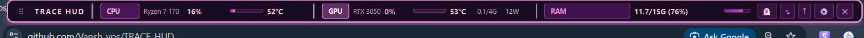
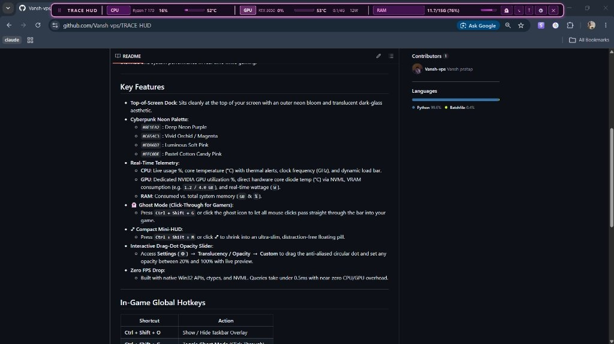
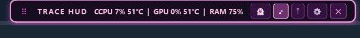
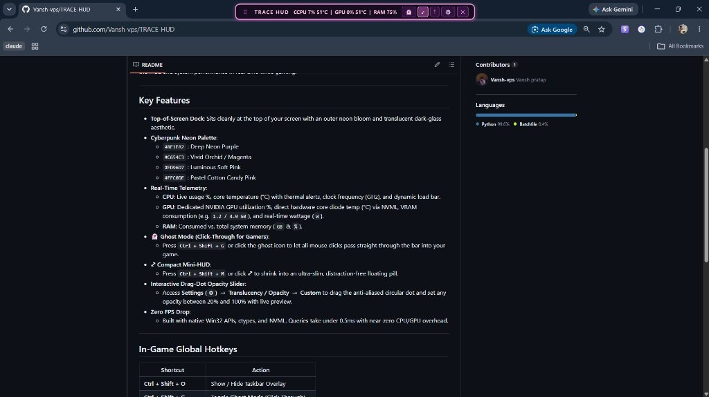
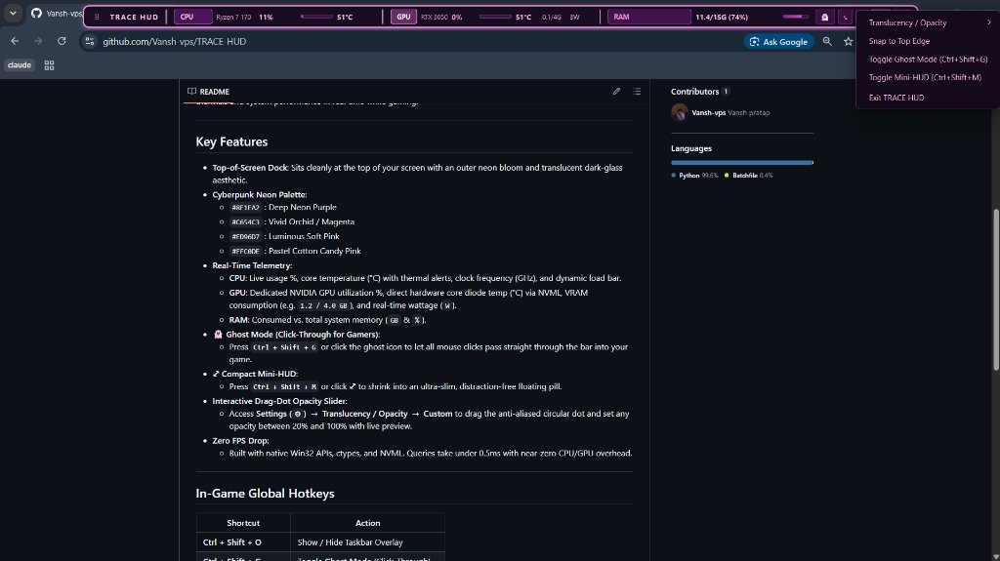

# TRACE HUD — Interactive Neon Gaming Taskbar Overlay

<p align="center">
  
</p>

A sleek, translucent **Synthwave/Cyberpunk Neon** gaming taskbar overlay designed for Windows laptops with dedicated GPUs (NVIDIA RTX & AMD Ryzen). Docks seamlessly at the top edge of your screen to monitor hardware thermals and system performance in real time while gaming.

---

## Visual Showcase

### 1. Expanded Mode (Full Telemetry)
Complete real-time monitoring including CPU clock, temperature & utilization bars, dedicated NVIDIA GPU diode temperature via direct NVML, VRAM consumption, wattage power draw, and RAM usage.

<p align="center">
  
</p>

---

### 2. Compact Mini-HUD Mode (`Ctrl + Shift + M`)
An ultra-slim, distraction-free floating pill showing essential CPU, GPU, and RAM stats while preserving your gaming view.

<p align="center">
  
</p>

<p align="center">
  
</p>

---

### 3. Settings & Custom Opacity Menu
Click the gear icon (**`⚙`**) to open the neon configuration dropdown:
- **Translucency / Opacity**: Quick presets (95%, 85%, 65%, 45%) or select **Custom** to drag the circular dot and set any exact percentage between 20% and 100% with real-time preview.
- **Snap to Top Edge**: Instantly re-center the bar at the top of your screen.
- **Ghost Mode**: Toggle click-through so in-game mouse clicks pass straight through.
- **Compact HUD**: Toggle between full telemetry and mini-pill view.

<p align="center">
  
</p>

---

## Key Features

- **Top-of-Screen Dock**: Sits cleanly at the top of your screen with an outer neon bloom and translucent dark-glass aesthetic.
- **Cyberpunk Neon Palette**:
  - `#8E1EA2` : Deep Neon Purple
  - `#C654C3` : Vivid Orchid / Magenta
  - `#ED96D7` : Luminous Soft Pink
  - `#FFC0DE` : Pastel Cotton Candy Pink
- **Real-Time Telemetry**:
  - **CPU**: Live usage %, core temperature (°C) with thermal alerts, clock frequency (GHz), and dynamic load bar.
  - **GPU**: Dedicated NVIDIA GPU utilization %, direct hardware core diode temp (°C) via NVML, VRAM consumption (e.g. `1.2 / 4.0 GB`), and real-time wattage (`W`).
  - **RAM**: Consumed vs. total system memory (`GB` & `%`).
- **Ghost Mode (Click-Through for Gamers)**:
  - Press **`Ctrl + Shift + G`** or click the ghost icon to let all mouse clicks pass straight through the bar into your game.
- **Compact Mini-HUD**:
  - Press **`Ctrl + Shift + M`** or click **⤢** to shrink into an ultra-slim, distraction-free floating pill.
- **Interactive Drag-Dot Opacity Slider**:
  - Access **Settings (`⚙`) $\rightarrow$ Translucency / Opacity $\rightarrow$ Custom** to drag the anti-aliased circular dot and set any opacity between 20% and 100% with live preview.
- **Zero FPS Drop**:
  - Built with native Win32 APIs, ctypes, and NVML. Queries take under 0.5ms with near-zero CPU/GPU overhead.

---

## In-Game Global Hotkeys

| Shortcut | Action |
|---|---|
| **Ctrl + Shift + O** | Show / Hide Taskbar Overlay |
| **Ctrl + Shift + G** | Toggle **Ghost Mode** (Click-Through for gaming) |
| **Ctrl + Shift + M** | Toggle **Compact Mini-HUD** vs Full Bar |
| **Double-Click Grip `⠿`** | Snap back to Top-Center |

---

## Quick Start

### Prerequisites
- Windows 10 / 11
- Python 3.10+
- Dependencies: `PySide6`, `pynput`

```powershell
pip install PySide6 pynput
```

### Launch Options
- **Silent Launch (Recommended - No console window)**:
  Double-click `run_taskbar_silent.bat`
- **Standard Launch (With debug console)**:
  Double-click `run_taskbar.bat`

---

## Project Structure

```
TRACE-HUD/
├── assets/                   # Screenshots and banner images
│   ├── banner_expanded.png
│   ├── banner_compact.png
│   ├── hud_expanded.jpg
│   ├── hud_compact.jpg
│   └── hud_settings.jpg
├── gaming_taskbar/
│   ├── hardware_monitor.py   # Telemetry engine (Win32, NVML, CPU/GPU/RAM)
│   ├── hotkey_manager.py     # Global background hotkey listeners
│   ├── main.py               # Main application entry point
│   ├── overlay_window.py     # PySide6 HUD GUI & custom slider
│   └── README.md
├── run_taskbar.bat           # 1-click launcher with console
├── run_taskbar_silent.bat    # 1-click headless launcher
├── .gitignore
└── README.md
```

---

## License
MIT License. Free to use and customize!
