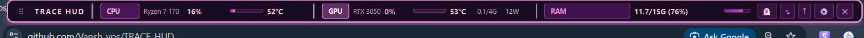
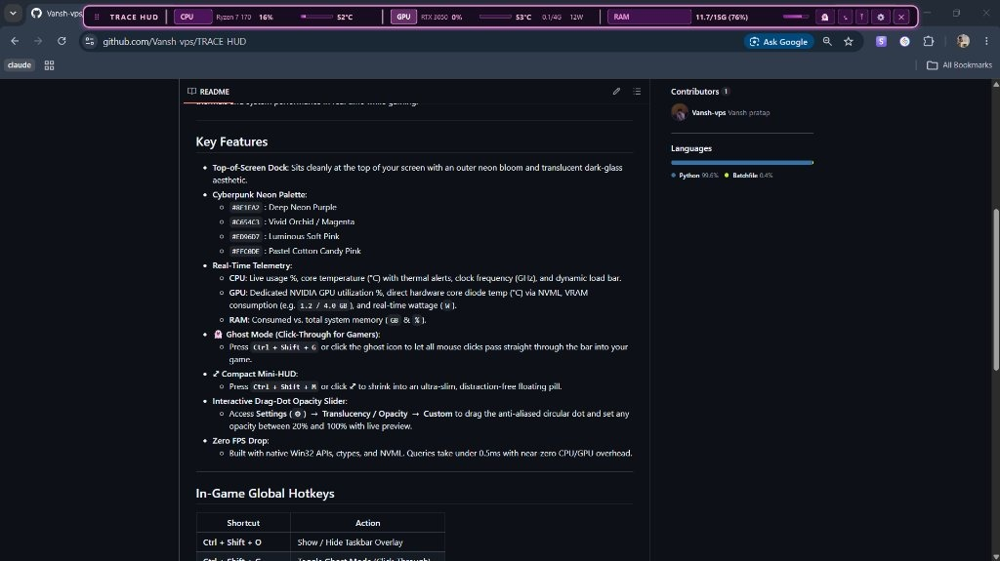
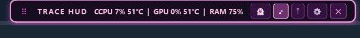
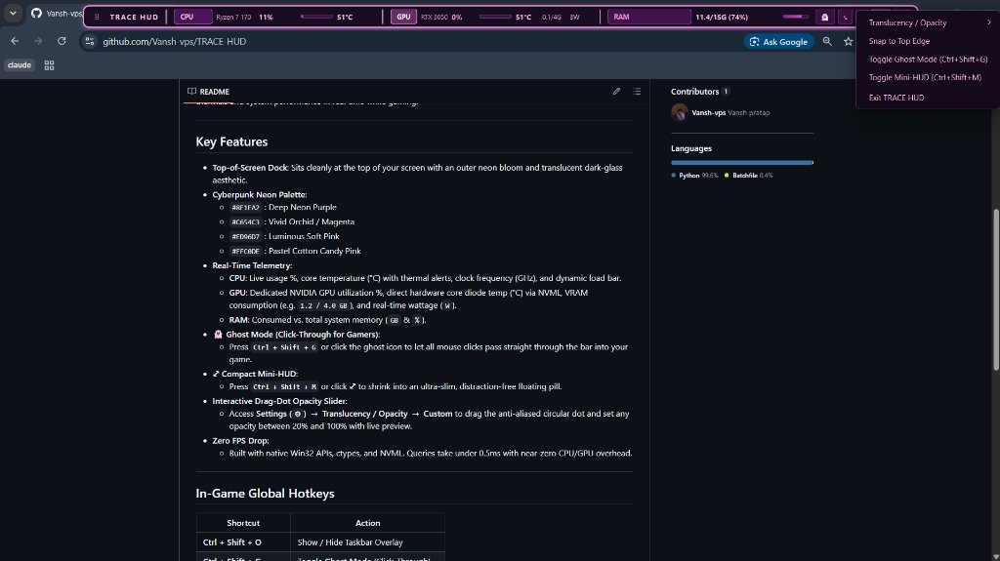

# ⚡ TRACE HUD — Interactive Neon Gaming Taskbar Overlay

  

A sleek, translucent **Synthwave/Cyberpunk Neon** gaming taskbar overlay designed for Windows laptops with dedicated GPUs (NVIDIA RTX & AMD Ryzen). Docks seamlessly at the top edge of your screen to monitor hardware thermals and system performance in real time while gaming.

---

## 📸 Visual Showcase

### 1. Expanded Mode (Full Telemetry)

  

### 2. Compact Mini-HUD Mode (`Ctrl + Shift + M`)

  

### 3. Settings & Custom Opacity Menu

  

---

## 🎮 Key Features

- **Top-of-Screen Placement**: Docks cleanly at the top edge of your screen with a vibrant **Synthwave/Cyberpunk Neon** theme (`#8E1EA2`, `#C654C3`, `#ED96D7`, `#FFC0DE`) and outer neon bloom.
- **CPU Telemetry**:
  - Live CPU Utilization (`%`) with dynamic colored progress bar.
  - CPU Temperature (`°C`) with thermal safety coloring (Cool <70°C, Warm 70-84°C, Alert ≥85°C).
  - CPU Name & Clock frequency.
- **Dedicated GPU Telemetry (NVIDIA GeForce RTX 3050)**:
  - Live GPU Utilization (`%`).
  - Core Diode Temperature (`°C`) via direct hardware NVML.
  - VRAM Usage (`Used / Total GB`).
  - Real-time Power Draw in Watts (`W`).
- **System Memory (RAM)**:
  - Total and consumed RAM (`GB` & `%`).
- **👻 Ghost Mode (Click-Through for Gamers)**:
  - When playing games, click `👻` or press **`Ctrl + Shift + G`**.
  - All mouse clicks and cursor actions pass directly through the bar into the game, preventing accidental clicks!
- **⤢ Compact Mini-HUD**:
  - Click `⤢` or press **`Ctrl + Shift + M`** to shrink into an ultra-slim, distraction-free floating pill.
- **Interactive Custom Opacity**:
  - Open **Settings (`⚙`) $\rightarrow$ Translucency / Opacity $\rightarrow$ Custom** to drag the circular dot and set any custom opacity between 20% and 100% with live real-time feedback.
- **Drag & Snap**:
  - Drag the grip (`⠿`) to position the bar anywhere, or double-click to snap back to top-center.
- **Zero FPS Drop**:
  - Built with native Win32 APIs, ctypes, and NVML. Queries take under 0.5ms with near-zero CPU/GPU overhead.

---

## 🚀 How to Launch

1. **Standard Launch (with console)**:
   Double-click `run_taskbar.bat`
2. **Silent Gaming Launch (no console window)**:
   Double-click `run_taskbar_silent.bat`

---

## ⌨️ Global Hotkeys (Usable Inside Any Game)

| Shortcut | Action |
|---|---|
| **Ctrl + Shift + O** | Show / Hide the Taskbar Overlay |
| **Ctrl + Shift + G** | Toggle Ghost Mode (Click-Through) |
| **Ctrl + Shift + M** | Toggle Compact Mini-HUD / Full Taskbar |
| **Double-Click Grip `⠿`** | Snap back to Top-Center |

---

## ⚙️ Customization

Click the **⚙** gear button on the bar to:
- Adjust opacity: **95% (Solid)**, **85% (Balanced)**, **65% (Translucent)**, **45% (Ghostly)**, or **Custom**.
- Snap back to top edge.
- Exit the HUD.
